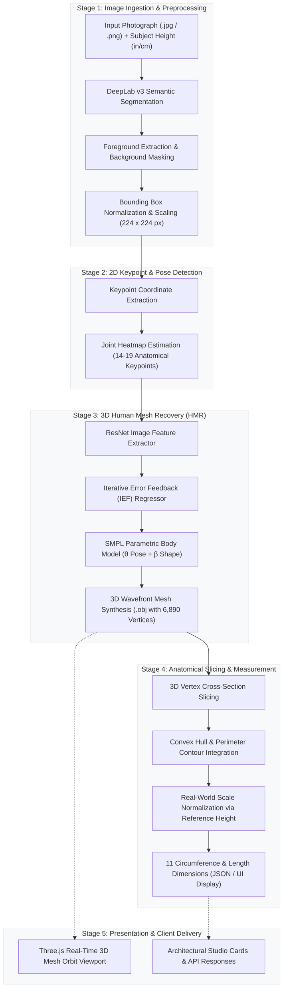

# Measure-Mate — AI Body Measurements & 3D Mesh Recovery

Measure-Mate is a state-of-the-art computer vision and deep learning application that reconstructs 3D human body meshes and calculates accurate anatomical body measurements from a single photograph.

Built on TensorFlow, Human Mesh Recovery (HMR), DeepLab semantic segmentation, and SMPL parametric body modeling, it pairs robust 3D vertex contour analysis with a modern architectural web studio interface.

---

## 📸 Screenshots & Previews

### Studio Lookbook Interface
The landing view showcases Scandinavian studio design, reference vertical ruler calibrations, and instant sample previews.

<div align="center">
  
</div>

<br/>

### 3D Measurement & Mesh Analysis Workspace
The 3-column workspace features photo ingestion, interactive Three.js 3D body mesh recovery with orbit controls, and live extraction of 11 verified anatomical measurements.

<div align="center">
  
</div>

---

## 🏗️ Architecture & Pipeline Overview

Measure-Mate transforms a single 2D photograph into a fully realized 3D mesh model with millimeter-scaled physical circumferences through a 4-stage pipeline:



### Detailed Pipeline Stages:
1. **Semantic Human Segmentation (DeepLab v3)**: Separates the subject from complex background clutter to produce a clean silhouette mask.
2. **2D Anatomical Keypoints**: Identifies anatomical joints (shoulders, elbows, hips, knees, ankles) to compute camera scale and focal projection.
3. **3D Mesh Recovery (HMR & SMPL)**: Infers 3D joint rotations and identity shape parameters ($\beta$) over 3 Iterative Error Feedback (IEF) loops, producing a 6,890-vertex 3D body surface.
4. **Vertex Slicing & Circumference Calculation**: Horizontal contour slicing along anatomical landmark planes computes continuous surface perimeters scaled against the user's reference height.

---

## 🌟 Key Features

1. **Precision 3D Body Mesh Recovery**
   - End-to-end inference using HMR (Human Mesh Recovery) and SMPL body topology.
   - Generates interactive 3D wavefront OBJ meshes (`test.obj`) rendered directly in Three.js with full orbit controls.

2. **11 Anatomical Body Measurements**
   - Automated contour slicing and vertex calculation:
     - **Circumferences:** Chest, Waist, Belly, Hips, Neck, Wrist, Thigh, Ankle
     - **Linear Dimensions:** Height, Shoulder Width, Arm Length
   - Instant unit toggling between Centimeters (cm) and Inches (in).

3. **Architectural Studio Interface**
   - **Single-Viewport Compact Layout (`100vh`)**: Zero overflow scrolling on desktop screens.
   - **Interactive Visualizer**: 3D mesh orbit viewport with measurement landmark pin callouts.
   - **Clean Default State**: Starts in a standby scanning grid without preloaded results until an image is processed.
   - **Quick Samples & Custom Upload**: Drag-and-drop or select preloaded studio samples with one-click inference.

4. **Multi-Page Web Suite**
   - **Home (`/`)**: Studio lookbook hero with reference ruler visualization, feature highlights, and interactive preview card.
   - **How It Works (`/how-it-works`)**: 4-stage pipeline architecture walkthrough.
   - **Measurements (`/measurements`)**: 3-column analysis workspace with image upload, Three.js 3D mesh canvas, and live metrics inspector.
   - **API (`/api`)**: Developer overview, cURL terminal preview, and early access registration.

---

## 🛠️ Tech Stack & Requirements

- **Python Version:** 3.7 (`Python 3.7.16`)
- **Deep Learning Framework:** TensorFlow 1.13.1, Chumpy 0.70
- **Computer Vision:** OpenCV (`opencv-python 4.10.0.84`), scikit-image, Pillow
- **Web Backend:** Flask 2.2.5, Flask-CORS, Jinja2
- **Frontend / 3D Graphics:** Vanilla JavaScript, Three.js (r128), OrbitControls, Plus Jakarta Sans & Inter typography

---

## ⚡ Quick Start & Installation

### Option 1: One-Click Start (Windows)
Double-click `Run Measure Mate.bat` located inside `Human-Body-Measurements-using-Computer-Vision/`.
The script automatically activates the `hmr` Conda environment, starts the Flask server, and opens `http://127.0.0.1:5000` in your default browser.

---

### Option 2: Conda Environment Setup (Manual)

1. **Create and activate a Python 3.7 Conda environment:**
   ```bash
   conda create -n hmr python=3.7 -y
   conda activate hmr
   ```

2. **Install dependencies:**
   ```bash
   pip install -r requirements.txt
   ```

3. **Pre-trained Models & Weights:**
   > [!NOTE]
   > Heavy model weights and checkpoints are excluded from Git to keep the repository lightweight. DeepLab will auto-download its pretrained checkpoint on first run, and the HMR SMPL model weights can be placed into `Human-Body-Measurements-using-Computer-Vision/models/`:
   - `models/model.ckpt-667589.*` (HMR checkpoint)
   - `models/neutral_smpl_with_cocoplus_reg.pkl` (SMPL neutral model)
   - `deeplab_model/` (DeepLab segmentation model, auto-cached on first execution)

4. **Start the Web Application:**
   ```bash
   cd Human-Body-Measurements-using-Computer-Vision
   python app.py
   ```

5. Open your browser and navigate to:
   ```
   http://127.0.0.1:5000
   ```

---

## 💻 Command-Line Usage (CLI)

Run measurements directly on any image from your terminal:

```bash
cd Human-Body-Measurements-using-Computer-Vision
python inference.py -i <path_to_image> -ht <height_in_inches>
```

**Example:**
```bash
python inference.py -i sample_data/sample1.png -ht 68
```

The CLI script outputs all calculated measurements to standard output and writes the reconstructed 3D mesh to `test.obj`.

---

## 📁 Repository Structure

```
Measure-Mate/
├── docs/
│   └── screenshots/                # Studio UI & workspace screenshots
│       ├── hero_studio_preview.png
│       └── measurement_workspace_preview.png
├── Human-Body-Measurements-using-Computer-Vision/
│   ├── app.py                      # Flask server, routing, and REST endpoints
│   ├── inference.py                # DeepLab & HMR inference pipeline
│   ├── extract_measurements.py     # SMPL vertex slicing & circumference algorithm
│   ├── networks.py                 # Neural network architectures
│   ├── requirements.txt            # Tested Python dependencies
│   ├── Run Measure Mate.bat        # One-click Windows starter
│   ├── src/                        # HMR & SMPL math utilities
│   ├── static/                     # Images, samples, styling assets
│   ├── templates/
│   │   ├── index.html              # Studio Home page
│   │   ├── how_it_works.html       # Pipeline architecture page
│   │   ├── run.html                # 3D Measurement workspace
│   │   └── api.html                # API Developer documentation page
│   └── test.obj                    # Last generated 3D mesh model
├── requirements.txt                # Root-level requirements file
├── .gitignore                      # Git exclusion rules for heavy models & cache
└── README.md                       # Master project documentation
```

---

## 📄 License
This project incorporates research models from the HMR (Human Mesh Recovery) paper and SMPL body model. Check the respective model licenses for commercial usage terms.
